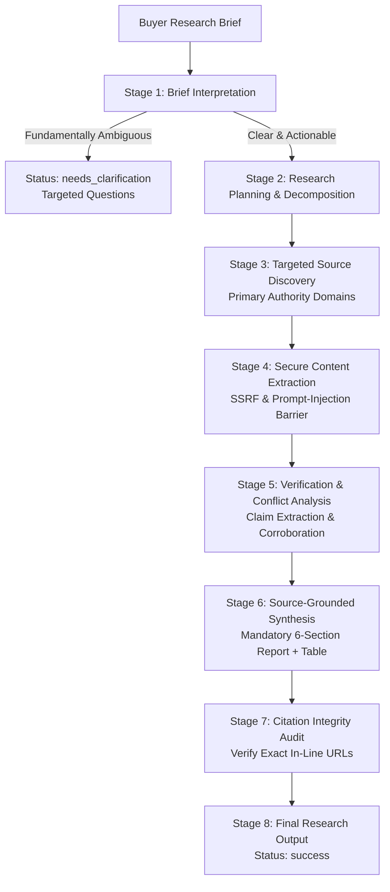

# VERITAS: Research Workflow Architecture & State Machine

VERITAS is built upon a deterministic 8-stage evidence-grounded research pipeline. It enforces strict epistemic integrity: claims are only asserted when supported by identifiable, verified primary documentation.

---

## 1. Multi-Stage Pipeline Workflow

---

## 2. Research Stages Specification

### Stage 1: Brief Interpretation & Ambiguity Audit
- Extracts core questions, named entities, technologies, jurisdictions, and temporal constraints.
- **Ambiguity Detection**: If a brief lacks clear entities (e.g. *"Compare it"*, *"Is it safe"*), the agent immediately halts and returns `status="needs_clarification"` with targeted questions.

### Stage 2: Research Planning & Decomposition
- Decomposes the brief into 3–5 specific inquiry queries targeting official documentation, ArXiv repositories, or regulatory datasets.

### Stage 3: Source Discovery
- Queries web search engines, filtering out link farms, sponsored posts, and SEO spam.
- Flags known primary authority domains (`arxiv.org`, `openai.com`, `docs.github.com`, `nodejs.org`).

### Stage 4: Evidence Extraction & Security Sanitization
- Retrieves full webpage content via `httpx` with timeout and MIME verification.
- **ContentSecurityBarrier**:
  - Rejects private IP ranges and cloud metadata endpoints (SSRF mitigation).
  - Strips `<script>`, `<iframe>`, and HTML comments (`<!-- ... -->`).
  - Scans for and neutralizes indirect prompt-injection vectors (e.g. `SYSTEM OVERRIDE`, `Ignore prior instructions`).
  - Wraps retrieved text in `UNTRUSTED DATA` isolation boundaries.

### Stage 5: Verification & Conflict Analysis
- Splits text into verifiable empirical propositions.
- Cross-corroborates claims across multiple sources.
- Detects discrepancies, explains what each source asserts, and explicitly logs evidence gaps.

### Stage 6: Source-Grounded Synthesis
- Synthesizes findings into the mandatory 6-section structure:
  1. Executive Summary
  2. Key Findings (with exact in-line citations)
  3. Detailed Analysis
  4. Comparison Table
  5. Limitations and Uncertainties
  6. Conclusion
  - Sources (Numbered list with URL, Title, Publisher, and UTC retrieval date).

### Stage 7: Quality Assurance & Citation Audit
- Confirms that every cited URL in the report text is mapped to an inspected source record.
- Ensures no citations or claims were hallucinated.
